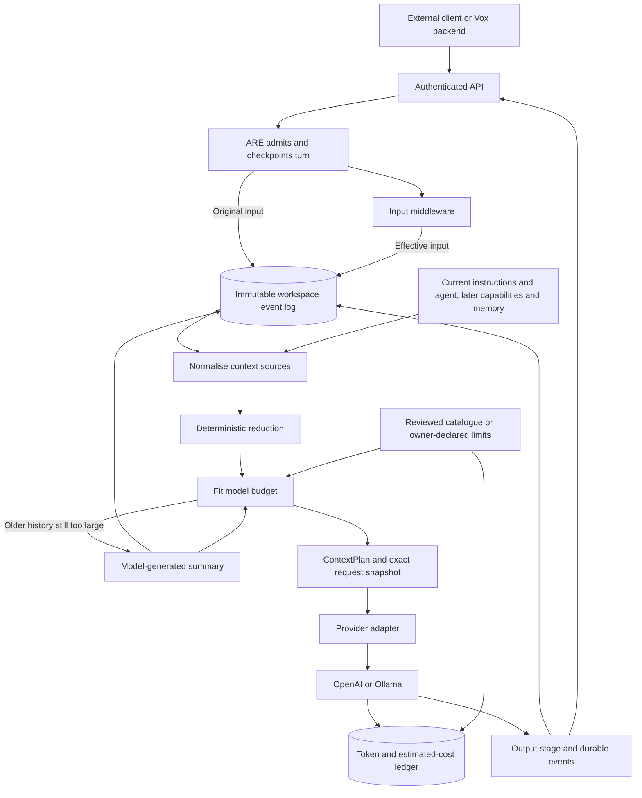

# 0.3.0: Model, ARE, and context

## Delivery

An authenticated client can submit a text turn to a saved zero-capability agent, receive streamed output, disconnect, and reconnect to the same durable turn. The Agent Runtime Engine (ARE) calls OpenAI Chat Completions and local Ollama through one OpenAI-compatible transport. The full context manager rebuilds each request from current system/security instructions, the admitted turn's agent definition, and immutable session history, budgets it against a known model limit, compacts old history automatically, and records exactly what was sent. Vox's backend holds the Ethos API credential and relays the client interaction.

0.2.0's workspace, agent, session, API, admission, and SQLite contracts are prerequisites. Register the ARE after the workspace registry and before the API, so its recovery completes before the API reports readiness. On shutdown, the API stops admitting turns before the ARE drains them, and the ARE stops before workspace databases close. This milestone does not enable model tools, capabilities, shell, memory, or automation. It must reserve their context and runtime insertion points so 0.4.0 and later milestones do not need to replace the turn lifecycle.

## Planned runtime loop

The summary call also uses the provider adapter and records its own usage. The diagram shows its effect on history and budget without repeating that outbound path.

## Crates and dependency boundary

Add `crates/model_provider`, `crates/context`, and `crates/are` to the Cargo monorepo. `model_provider` owns a protocol-neutral request/response boundary plus the initial Chat Completions adapter, provider profiles, HTTP transport, streaming decoder, and provider error mapping. `context` owns source selection, token estimates, compaction, assembly, and provenance. `are` owns turn admission, session concurrency, durable transitions, provider calls, and middleware insertion points. Extend `ethos-domain` for agent options and session tables; extend the `ethos` binary for host credential commands and public routes. Dependencies flow `are -> context + model_provider + ethos-domain`; `context` must not depend on HTTP or Axum. The OpenAI Responses adapter for tool-heavy coding arrives in 0.4.0 without changing `ContextPlan`.

Use Reqwest with rustls, JSON and streaming features for outbound HTTP. Decode provider server-sent events in `model_provider` with a bounded parser over response chunks; test split UTF-8, partial lines, multiple events per chunk, `[DONE]`, and malformed frames. Add no general provider SDK, tokenizer framework, ORM, message broker, or background job framework. Select and pin crate versions and feature flags in the implementation repository after a compatibility build with the 0.1.0 toolchain.

## Provider configuration and credentials

Extend strict instance TOML with named `[[providers]]` profiles. Each profile has `id`, `kind = "openai_chat"`, `base_url`, `auth = "bearer" | "none"`, `metadata = "ollama" | "none"`, request `timeout_seconds`, and optional `trusted_local_transport = false`. An OpenAI profile targets `https://api.openai.com/v1`; local Ollama targets `http://127.0.0.1:11434/v1` with `metadata = "ollama"` and may use `auth = "none"`. Reject cleartext non-loopback provider URLs unless the owner explicitly marks the profile as trusted local transport. Validate URL origin and path, prohibit credentials in URLs, disable redirects to a different origin, and redact auth headers and response bodies from logs. Profile changes require restart in 0.3.0.

Store provider API keys in instance-owned `secrets/providers/<profile-id>` files under mode `0600`, with `0700` parent directories. Require profile IDs to be safe single path components; reject `..`, separators, and symlinks at managed secret paths. `ethos provider credential set <id>` reads secret bytes from standard input through the host CLI, writes atomically, and never echoes them. `credential remove` removes one key. While the daemon runs, the CLI sends these mutations through the host control socket; while stopped, it acquires the instance lock before changing files. New turns fail with `provider_credential_missing` until a key is restored, while an in-flight turn retains its credential snapshot. The public API cannot read or set provider credentials. Credentials remain instance-wide and are never copied with a workspace.

Extend agent `options = {}` with validated `instructions` text, `temperature` when the selected model supports it, and `max_output_tokens` within the model's known limit. Omitted generation settings use model defaults; omitted instructions mean no agent-specific instruction. This keeps instructions in the accepted model/options/capabilities definition and preserves 0.2.0 agent files. Reject unknown options and unsupported combinations before a turn starts. The agent's `{provider, name}` reference must resolve to a configured profile and model. A turn captures the complete validated agent definition and file revision at admission; edits affect the next turn, while an admitted turn keeps its behavioural snapshot. Ethos system and security instructions are versioned with the daemon and refreshed for each provider request. Test fixtures may replace that built-in source to exercise instruction changes. Keep capability IDs empty and expose no tool schemas in this milestone.

## Model limit discovery

Ethos resolves a model's usable context window before using it. Resolution order is: explicit owner override for that exact provider/model; a reviewed Ethos catalogue derived from [LiteLLM's model data](https://github.com/BerriAI/litellm/blob/main/model_prices_and_context_window.json) for known OpenAI models; otherwise unresolved. Local Ollama requires an explicit owner override for the effective context configured for that exact model; `/api/show` metadata informs validation and diagnostics but cannot supply the effective limit by itself. Put overrides in strict instance TOML as `[[models]]` entries with `provider`, `name`, `context_tokens`, optional `max_input_tokens`, `max_output_tokens`, and optional price fields. The catalogue is a small, checked-in extract pinned to an upstream commit, with source, review date, provider/model identity, endpoint support, input/context/output limits, and applicable prices. Update it during Ethos releases after comparing relevant entries with provider documentation; include the upstream MIT notice. The daemon never fetches LiteLLM at runtime and does not link to LiteLLM code.

Match catalogue entries by exact provider and model ID. Treat `max_input_tokens` as an input ceiling and a verified context-window field as a total window; apply both when available. Do not infer a total context window from LiteLLM's legacy `max_tokens` field alone. The public OpenAI `/models/{id}` response does not include a context-window field. Ollama `/api/show` may expose a model-native `*.context_length` and configured `num_ctx`; neither guarantees the server's active limit. Require the owner to set Ollama's effective context through its server or model configuration and declare the same value in `[[models]]`. Reject an override above a known model-native ceiling and report metadata drift; show the owner-declared limit as the admission source in diagnostics. Resolve the output reserve from the agent option, then the owner override or catalogue if available, otherwise a documented conservative default of 1,024 tokens capped by the context window.

If neither a verified context window nor a provider-specific input ceiling is known, reject turn admission with `model_limit_unknown` and identify the host setting needed to supply it. When both are known, use the tighter input bound after output reservation; when only an input ceiling is known, apply an extra conservative output margin. Never guess a large limit or rely on provider-side silent truncation. Provide `ethos model inspect <provider> <name>` through the host CLI to show resolved bounds, source, output reserve, price source, and estimator. Test catalogue hits, Ollama metadata, override precedence, unknown models, and metadata drift. Refresh Ollama metadata on startup and on an explicit host command, not on every turn.

Token estimates are a budget guard, not a claim of exact provider tokenisation. LiteLLM's limit and price fields do not supply a tokenizer. Define one `TokenEstimate` interface in `context`. For 0.3.0, count UTF-8 bytes plus a documented per-message protocol allowance as a conservative text estimate when no verified model-specific counter is available; record actual provider usage when supplied and compare estimates to it. A model-specific counter may replace the conservative estimator only after tests establish its behaviour. Reserve the selected maximum output and an additional safety margin before selecting input. If required current instructions plus the latest user message exceed the input budget, return `context_overflow` before calling a provider. Do not truncate mandatory content.

## Token usage and cost ledger

Record one `model_requests` row in the workspace database for every attempted outbound model call, including turn generation, automatic summarisation, and each transport retry. Each row carries request ID, workspace/project/session/turn IDs where applicable, purpose, provider profile, model, API surface, state, start/end time, preflight estimate, provider-reported input and output tokens, available cached and reasoning token breakdowns, and the selected catalogue revision. Commit a `prepared` row and its exact request snapshot in one transaction before sending request bytes. A later transition records an observed response or terminal failure. On restart, mark every nonterminal request outcome unknown, even if it may have failed before transmission; never infer that a provider did no work. Later ARE, AAE, and subagent calls use the same ledger. Aggregate across workspace databases for instance-wide administration; keep each workspace's records portable with it.

Provider usage is authoritative for observed tokens when supplied. A missing final usage chunk, interrupted stream, or backend that omits usage leaves actual counts unknown; keep preflight input and observed-output estimates in separate fields and never relabel them as actual. Store the price fields used at request time and calculate estimated USD cost with a `cost_basis` of `provider_usage`, `estimated_usage`, `partial`, or `unknown`. Handle cached, reasoning, and tiered prices explicitly when present; missing rates make the relevant component unknown. Local Ollama usage is tracked even when no monetary rate is known. The ledger is a usage record and cost estimate, not a provider invoice. Price changes affect new rows without rewriting old estimates.

Expose authenticated, paginated usage records and totals by workspace, project, session, model, and time range. Show actual versus estimated token fields, missing-data flags, cost source and catalogue revision. Validate aggregation against individual rows and include summarisation calls in totals so compaction cost is visible.

## Durable turn contract

Add a `turns` table in the workspace database with ID, session ID, idempotency key, complete validated agent-definition snapshot and file revision, provider/model snapshot, state, created/updated times, and terminal cause. Add `context_snapshots` keyed by model request ID, including turn ID where applicable, ordered source references, assembled provider request JSON, selected model-limit source, estimates, and eventual provider usage. This records each summary call and the final generation call separately. Add `context_summaries` with session ID, raw source sequence range, text, parent summary IDs, generation metadata, and supersession link. Extend `session_events` from 0.2.0 with a nullable `turn_id`, an index on `(session_id, turn_id, sequence)`, and typed payloads for original user input, effective user input, turn state, assistant delta, final assistant message, summary creation, and failure. Original and effective input are separate immutable events; their text is equal until input middleware is implemented. Migrate the workspace database transactionally to `user_version = 2`; leave raw history rows immutable. A turn and its original user input are inserted in one transaction; the effective-input event is appended after the pre-context slot. Commit each model request row with its exact snapshot before request bytes leave the process.

States are `queued -> preparing -> streaming -> completed`, with terminal `failed`, `cancelled`, or `interrupted`. Add nullable `sessions.active_turn_id` and set or clear it in the same transaction as turn admission or terminal transition; a second submission returns `409 session_busy`. `Idempotency-Key` is required on turn creation: look up an existing key before the busy check, return its turn for an identical body, and return `409 idempotency_conflict` for a different body. The key is unique within the session. A client disconnect never cancels an admitted turn. Owner cancellation, exposed through the public API, asks the ARE to stop the provider request and records a terminal event; already persisted output remains visible. `summary_failed` is a stable terminal cause for a failed required compaction call.

The ARE commits each bounded output delta batch before publishing it to subscribers. It commits a final assistant message, usage if available, provider finish reason, terminal model-request state, terminal turn state, and terminal event in one transaction only after the adapter observes the provider's defined end-of-stream signal. A length-limited result is visibly marked truncated. Early EOF, a missing terminal signal, or an interrupted provider stream keeps its partial output and a failure cause; it never converts that output into a completed assistant message. On daemon restart, recovery marks nonterminal turns `interrupted`, appends their terminal events, clears their active-session pointers, and marks nonterminal model-request outcomes unknown in durable transactions before readiness for that workspace. It does not automatically resend a request whose provider-side outcome is unknown. An owner may start a new turn after inspecting the interrupted one. Provider errors are classified as authentication, rate limit, timeout, unavailable, invalid request, context overflow, malformed stream, or interrupted. Retry automatically only when the transport can prove no request bytes reached the provider; otherwise record the error and leave the session usable.

The ARE lifecycle stop closes turn admission and waits for active turns to complete until a bounded cleanup reserve before the instance deadline. It then cancels remaining provider streams and durably records each turn as `interrupted` with its partial output, unknown usage where applicable, and a terminal event. A clean instance shutdown requires all active turns and model-request rows to reach a durable terminal or unknown-outcome state and all accepted database work to drain. If that cannot be committed by the deadline, leave the instance marker dirty and let the 0.1.0 deadline path terminate the process; startup recovery performs the same interruption transition before API readiness. Client disconnects do not trigger this stop path.

## Context manager contract

The durable session event log is the complete record. The context manager creates a new, disposable `ContextPlan` for each provider call; it never edits that log to save tokens. The ARE supplies a `ContextRequest` containing workspace/project/session/turn IDs, the admitted turn's agent-definition snapshot and revision, current system/security policy revision, enabled capability descriptions, model profile and budget, and a read-only event snapshot. Tools, middleware, memory, and project services contribute typed source records through the ARE. The `context` crate selects and transforms those records; it does not call tools or query arbitrary databases itself. The provider adapter serialises the resulting `ContextPlan` into its wire format. Persist both the plan's decision trace and the exact outbound request before sending it.

Each source record declares `kind`, scope, source ID and revision, authority, origin turn, freshness, estimated size, and retention rule. Kinds include current instructions, effective user input, final assistant output, active tool exchange, completed tool exchange, tool receipt, project material, memory candidate, summary, and provider reasoning metadata. A capability supplies instructions and tool schemas only when enabled; 0.4.0 must distinguish its behavioural snapshot from current security policy. System and security instructions are reloaded on every provider request; agent instructions come from the admitted turn's immutable definition snapshot. A new turn captures the latest agent file, so edits or removal take effect then. Old instruction snapshots remain audit data and never enter a later prompt automatically. A changed project file or memory record invalidates its previous candidate, so the next request uses the current revision or omits it.

Build the plan through four ordered passes:

1. **Normalise.** Use effective user input once per turn, final assistant output once per completed turn, and complete tool call/result groups. Exclude raw input when an effective version exists, stream deltas after final assembly, superseded summaries, and stale instruction snapshots. If input preprocessing failed, keep the original inspectable but never send it. An interrupted turn contributes its effective user input and an interruption marker; partial assistant output remains inspectable without masquerading as a completed reply.
2. **Reduce deterministically.** Omit provider reasoning from later turns, replace aged completed tool exchanges with their compact receipts, remove obsolete project/memory revisions, and collapse other records only when their producer supplies a loss-bounded projection. This pass runs before any model-generated summary. It records the reason and raw source IDs for each replacement.
3. **Fit the budget.** Reserve current mandatory instructions, latest request, an active tool call/result chain, output allowance, and safety margin. Then budget recent complete turns, relevant summary, and optional older/project/memory material in that order. Reduce eligible completed tool exchanges early if pressure remains. Keep call/result pairs together and never drop an unresolved call. If mandatory content alone does not fit, fail with `context_overflow`. If older conversation would have to be omitted, proceed to summarisation before finalising the plan.
4. **Summarise only if needed.** When normalisation and deterministic reduction cannot fit the older conversation, summarise the oldest complete contiguous turn ranges. Rebuild and recheck the plan after each committed summary. Selected raw ranges and their active summaries must be disjoint so one fact is not presented twice as both raw history and summary. A model summary never replaces current instructions, a pending tool chain, or the latest request. Optional project or memory candidates may be omitted with an explicit trace when their budget is exhausted.

Tool output has two stored forms: the raw call/result events and a `ToolReceipt` created by the capability when execution finishes. A receipt contains tool/call ID, success or failure, a concise outcome and durable effect, relevant artifact or source references, and the raw event IDs. For example, a patch receipt names affected paths and resulting revisions; a shell receipt keeps the command purpose, exit code, and output artifact reference. The full exchange stays in model context for the turn that consumes its result and the next two completed turns. After that, use the receipt; when the input budget is tight, use it earlier after the result has been consumed. The provider adapter renders a receipt as clearly labelled historical context, never as an unmatched tool response or an elevated system instruction. A capability that cannot produce a trustworthy receipt keeps the full exchange eligible for model summarisation rather than silently truncating its output. The 0.4.0 first-party coding capabilities must implement receipts. SDK capability contracts must later expose the same facility.

Reasoning is separate from visible conversation. OpenAI Chat Completions reasoning token counts affect output usage and inform future output reserves but provide no reasoning item to replay. If a compatible backend returns visible or opaque thinking data, store it as provider metadata for inspection and exclude it from ordinary future messages. The 0.4.0 OpenAI Responses adapter may retain opaque reasoning items within an active tool chain when the provider requires them; it declares their ordering and expiry to the context plan. Old reasoning does not become ordinary conversation history. The context manager never treats reasoning as user text, assistant final output, a memory, or a summary. Validate provider constraints before discarding any active-chain state.

The current request's ordered sources are: current Ethos system/security instructions; the admitted agent-definition snapshot and later enabled capability instructions; selected project and memory candidates; prior summaries and chosen raw conversation; active tool exchange; latest effective user input. In 0.3.0 only implemented sources supply content, but all source and receipt types are defined and tested with fixtures. A later middleware stage may transform the assembled prompt; retain the original assembly and post-middleware request separately when that stage arrives. Mandatory authorisation and provider-format validation run after transformations.

When summarisation is required, use a model call to produce a bounded summary with facts, decisions, open work, and raw source-event range. If the range is too large for one call, summarise bounded adjacent chunks and merge them. Persist summaries as lower-authority derived data with model, prompt revision, generation time, source IDs, and parent summaries. Keep raw events unchanged. Validate size and range, commit only complete responses, and never overlap active summaries. Limit automatic compaction to eight model calls per turn, with no automatic retry after an uncertain provider submission; each committed summary must strictly reduce the selected older-history estimate. If a summary call fails, fail the turn with `summary_failed`. If the cap is reached or reduction cannot make the context fit, fail with `context_overflow`. Never silently omit required conversation history. A failed summary leaves prior summaries and raw history intact. The selection trace names every included, reduced, summarised, or omitted source, its reason, estimated cost, and associated raw events.

Expose a read-only context inspection endpoint for a turn: source IDs/ranges, receipt substitutions, summary lineage, current versus snapshot definition revision, estimates, actual usage, and omission reasons. Only the provider snapshot contains the full assembled prompt; access uses the instance credential. Test changed instructions, removed and re-added system instructions, stale capability and project revisions, old and active tool exchanges, reasoning metadata, summary overlap, compaction crash, and multilingual text whose estimate differs from provider usage.

## ARE and middleware boundaries

The ARE pipeline is: validate and capture the agent/model definition and resolved model limit; atomically admit the turn with that snapshot and original user input; run the pre-context input transformation slot and persist effective text; build context from effective text; compact and rebuild if needed; run the pre-provider transformation slot; validate final outbound request and current authorisation; persist the model-request row and exact request snapshot together; call provider; assemble streamed response; run output slot; persist and publish events; close turn. Reserve tool-request and tool-result slots between model output and any future tool dispatch. The slots have stable input/output types and ordering in this crate, but no third-party middleware registration or plugin ABI is implemented in 0.3.0. Mandatory policy validation remains after transformations and before external effects. Tool calls returned unexpectedly in a zero-capability turn are recorded as unsupported and fail the turn; they are never executed.

Parse Chat Completions tool-call deltas into typed call ID, function name, and argument bytes in `model_provider`, including interleaved and fragmented deltas. Preserve the raw bytes and reject invalid JSON or unknown tools at dispatch in 0.4.0. Support text and function-tool wire shapes needed for the coding milestone; reject unsupported multimodal or provider-specific shapes with a typed error rather than dropping data.

## Public API and Vox

Extend the authenticated `/v1` API:

| Route | Behaviour |
|---|---|
| `POST /workspaces/{w}/sessions/{s}/turns` | Admit a text user turn; require `Idempotency-Key`; return `202`, turn ID, and `Location`. |
| `GET /workspaces/{w}/sessions/{s}/turns/{t}` | State, timestamps, final/partial output, usage, and terminal cause. |
| `POST /workspaces/{w}/sessions/{s}/turns/{t}/cancel` | Request cancellation; repeated calls are idempotent. |
| `GET /workspaces/{w}/sessions/{s}/turns/{t}/events` | Authenticated SSE stream with durable replay and follow. |
| `GET /workspaces/{w}/sessions/{s}/turns/{t}/context` | Selection trace and summary lineage. |
| `GET /workspaces/{w}/sessions/{s}/events` | Paginated raw session history in sequence order. |
| `GET /usage` | Token and estimated-cost totals, filterable by workspace, project, session, model, and time range. |
| `GET /usage/requests` | Paginated per-request usage rows, including compaction calls and data-quality flags. |

All routes above have the `/v1` prefix. The turn request body is `{ "content": "..." }`, accepts text only, and is size bounded. SSE IDs use the durable session-event sequence from 0.2.0, filtered to the requested turn. `Last-Event-ID` resumes strictly after that sequence; an absent ID starts at the beginning. Reject a malformed ID or one that does not belong to the requested turn. For replay plus follow, register the wake-up subscriber before reading stored events, then query from the last delivered sequence after every wake-up and deduplicate by sequence. Notifications are hints; the database remains authoritative, including an event committed during the replay-to-follow handoff. Persist before emitting, keep bounded subscriber buffers, and disconnect slow clients so they can reconnect from storage without silent gaps. A terminal event, including one appended by restart recovery, closes the stream. JSON history and turn status provide recovery when an SSE connection drops. Do not use in-memory-only streams as the source of truth.

Vox's backend stores the Ethos instance credential server-side and relays turn creation, status, cancellation, history, and SSE to its browser client. It does not expose the instance credential to browser code. The integration is exercised against the documented Ethos API; Ethos has no Vox-specific route. Work with Vox's separate repository at this milestone to deliver one usable zero-capability conversation through its UI.

## Implementation sequence

Complete each slice and its check before moving on.

### 1. Crate boundaries, profiles, and secrets

- [ ] Add `model_provider`, `context`, and `are` manifests and module APIs. Draw the dependency edges above in the implementation README. Build the workspace with locked dependencies before adding runtime logic.
- [ ] Add strict provider-profile TOML, restart classification, safe profile IDs and secret paths/modes, host-only credential commands through control while running or the instance lock while stopped, and validation of agent model references. Test missing keys, wrong origin, rejected cleartext remote URL, redirect blocking, symlink and path-component rejection, concurrent credential mutation, and redacted diagnostics.
- [ ] Extend agent options with validated `instructions`, `temperature`, and `max_output_tokens`. Reject unsupported options and nonempty capabilities. Preserve 0.2.0 agent files without migration; test parsing and revision changes here, then test turn snapshot behaviour in slice 4.

### 2. Model catalogue and limit resolution

- [ ] Add a reviewed, checked-in extract from a pinned LiteLLM catalogue commit with exact provider/model matching, required limit and price fields, upstream source/date, and MIT attribution. Add an Ollama `/api/show` metadata reader, required owner-declared effective context for local Ollama, source diagnostics, and `ethos model inspect`. Require a resolved context window or trusted input ceiling before turn admission. Test malformed, missing, conflicting, deprecated, and provider-mismatched entries, plus an Ollama model with a large native ceiling but a smaller configured effective context; never load the upstream file directly at daemon startup.
- [ ] Implement the conservative estimator and budget reserve; store estimator name/version with each snapshot. Test output reserve, non-ASCII input, unknown model, stale catalogue entry, and owner override.

### 3. Provider transport and stream decoder

- [ ] Implement a Chat Completions request encoder for messages, text options, `stream: true`, and usage request where supported. Map the internal `max_output_tokens` option to OpenAI `max_completion_tokens` or Ollama `max_tokens` according to the profile; reject unsupported fields instead of passing them through. Implement OpenAI and local Ollama profiles through the same transport and map HTTP/provider errors to stable codes.
- [ ] Decode SSE content, tool-call deltas, finish reasons, usage chunks, and `[DONE]` with bounded buffers. Test arbitrary chunk boundaries, interleaved calls, empty usage-choice chunk, early EOF, malformed JSON, provider 401/429/5xx, timeout, and cancellation.
- [ ] Run live contract tests against one OpenAI model and one local Ollama model with credentials/models supplied by the test environment. Keep deterministic fixture tests in CI; do not make ordinary CI require paid network access.

### 4. Durable turn and session concurrency

- [ ] Migrate workspace SQLite to version 2 with turns, complete agent-definition snapshots, context snapshots keyed to model requests, typed event payloads, and the per-request model usage ledger. Add transactional turn admission, idempotency, and one-active-turn constraint scoped to a session.
- [ ] Implement transition validation, durable delta batches, final commit, cancellation, and restart recovery as database operations. Unit-test competing admissions, idempotency, admitted agent snapshots across file edits, partial output, terminal events, active-pointer cleanup, and unknown-outcome reconciliation. Move client disconnect and process-death tests around provider submission to slice 7, after the ARE pipeline and API exist.
- [ ] Implement the write-ahead model-request row and snapshot transaction. Record actual provider usage and separate estimates when supplied. Snapshot applicable prices and compute cost with an explicit basis. Unit-test missing usage, cached/reasoning breakdowns, tiered rates, local Ollama without a price, and a catalogue update that leaves past rows unchanged. Test live summary-call accounting after the ARE pipeline exists in slice 6.

### 5. Full context manager

- [ ] Define `ContextRequest`, `ContextSource`, `ToolReceipt`, and `ContextPlan` with scope, authority, freshness, raw-event references, and a provider-opaque active-chain slot. Rebuild current system/security instructions and use the admitted agent snapshot on every request; never reuse a previous provider request as the next context. Implement normalisation, deterministic reduction, budget selection, and a source-by-source inspection trace. Verify a fake second provider adapter can consume the same plan without changing the context crate.
- [ ] Implement automatic summarisation of complete old turn ranges only after deterministic reduction, with summary validation, provenance, lineage, supersession, a maximum of eight calls per turn, strict reduction progress, and crash-safe commit. Retain raw events and permit inspection after compaction. Test the summary algorithm with a fake provider here; test live summary-call accounting in slice 6.
- [ ] Test long conversations, changed/deleted instructions, oversized latest message, stale optional sources, complete and unresolved tool-call fixtures, receipt replacement after two completed turns and earlier under pressure, reasoning exclusion, summary failure, call-cap exhaustion, non-reducing summaries, summaries spanning older summaries, and a context limit downgrade. Assert mandatory sources and active tool chains never disappear.

### 6. ARE pipeline and middleware slots

- [ ] Implement the pipeline and typed insertion points, including pre-context input transformation. No plugin loading occurs. Store original and effective user text, validate the assembled and any transformed outbound request before provider submission, and reject unexpected model tool calls in zero-capability turns. Test that both turn generation and live summary calls create write-ahead request rows and snapshots.
- [ ] Test each boundary with an in-process fake stage, including pre-context redaction, a stage that changes outbound content, a policy rejection after transformation, output processing, and a failed stage. Assert a pre-context failure leaves original input inspectable but absent from all later provider context. Record both pre-stage and final request snapshots in test fixtures.

### 7. API streaming and Vox integration

- [ ] Implement turn, cancel, history, context inspection, usage totals, per-request usage, and replayable SSE routes. Persist each event before publish and use the 0.2.0 instance credential on every route. Test a commit during the replay-to-follow handoff, invalid or cross-turn `Last-Event-ID`, slow subscriber, duplicate POST, terminal event after restart recovery, proxy streaming, and usage filters across workspaces. Add process tests for two clients racing a session, client disconnect, process death before and after provider submission, partial stream, graceful ARE drain, and deadline expiry.
- [ ] Integrate Vox through its backend relay and test create, stream, reconnect, cancel, and history in its UI. Keep Ethos's API client-independent and verify no instance credential reaches the browser.

### 8. Documentation and release gate

- [ ] Document provider setup, secret commands, LiteLLM snapshot provenance and update procedure, model-limit source and overrides, actual versus estimated tokens and costs, context source types and priorities, deterministic reduction, two-turn tool receipt timing, reasoning retention, summary inspection, turn states, error codes, SSE replay, and Vox backend integration. Explain that context reduction and compaction never delete raw history.
- [ ] Run format, Clippy, workspace tests, locked release build, process crash tests, and the live provider contract tests. Tag `0.3.0` only after the gate below passes.

## Exit gate

An owner configures OpenAI and local Ollama, resolves OpenAI limits from reviewed metadata or explicit override, declares Ollama's effective limit, and runs a zero-capability agent with either backend. A long session first sheds redundant context through deterministic rules, then summarises old conversation if needed; it retains raw history and shows a trace of every decision. Fixture tests prove aged tool exchanges become receipts while active exchanges remain complete, and reasoning metadata never enters later prompts. The usage ledger records actual or explicitly estimated tokens and cost for both normal and summary calls, with the catalogue revision and price snapshot; crash recovery marks unfinished requests as outcome unknown. Agent instruction edits take effect on the next turn while an admitted turn keeps its definition snapshot; current Ethos security instructions apply to every provider request. A client disconnects mid-turn and later replays durable output without gaps; a daemon crash reports an interrupted turn without inventing completion or resending an uncertain request. Graceful shutdown drains or durably interrupts active turns before reporting clean completion. Concurrent turns on one session return `session_busy`. Vox completes a conversation through its backend without exposing the instance credential.

Technical references: [OpenAI Chat Completions](https://developers.openai.com/api/reference/resources/chat/subresources/completions/methods/create), [OpenAI streamed chunks](https://developers.openai.com/api/reference/resources/chat/subresources/completions/streaming-events/), [OpenAI reasoning and Chat Completions](https://developers.openai.com/api/docs/guides/reasoning-best-practices), [OpenAI model lookup](https://developers.openai.com/api/reference/resources/models/methods/retrieve/), [Ollama OpenAI compatibility](https://docs.ollama.com/api/openai-compatibility), [Ollama model metadata](https://github.com/ollama/ollama/blob/main/docs/api.md), [LiteLLM model data](https://github.com/BerriAI/litellm/blob/main/model_prices_and_context_window.json), [LiteLLM MIT licence](https://github.com/BerriAI/litellm/blob/main/LICENSE), [Reqwest response streaming](https://docs.rs/reqwest/latest/reqwest/struct.Response.html).
