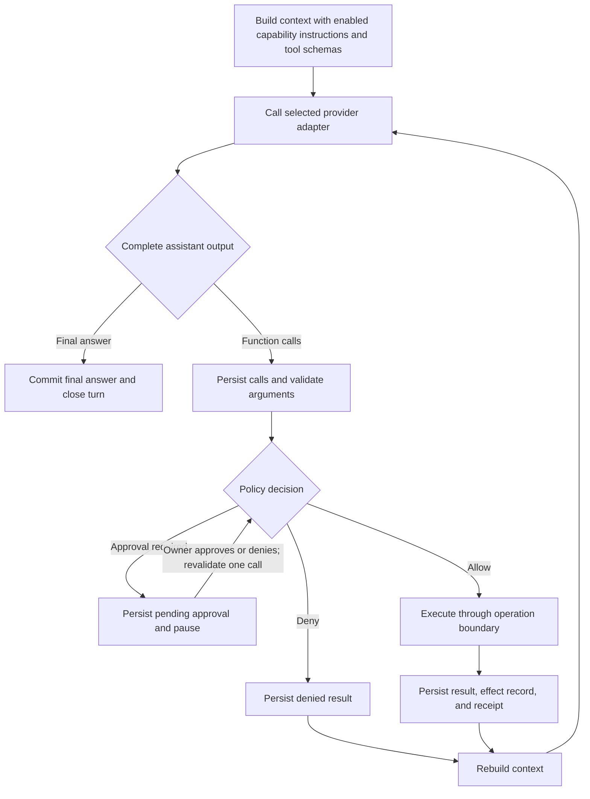

# 0.4.0: Coding agent

## Delivery

An owner enables the first-party filesystem, shell, skills, and patch capabilities on a saved agent. In a project-scoped session, that agent can inspect files, make a checked edit, run a sandboxed test, and report the result. Each model tool call passes one authorisation path before execution. A request needing approval pauses the turn durably; an authenticated owner can approve or deny it after reconnecting or restarting Ethos. OpenAI coding models use a Responses adapter that retains only active-chain reasoning items; compatible Chat Completions models, including local Ollama, remain usable when they support the required function tools.

0.3.0 supplies durable turns, a protocol-neutral `ContextPlan`, tool-call parsing, middleware slots, and the model-request ledger. Extend those contracts rather than building a second agent loop. The agent-definition snapshot captured at turn admission fixes that turn's enabled capabilities and configuration. Current Ethos security instructions and current workspace/project grants are re-evaluated before each effect. Native plugins and the public Rust SDK arrive in 0.6.0; this milestone uses built-in capabilities behind the same internal operation boundary.

## Tool loop and durable state

The provider stream is complete before any call is dispatched. Validate tool name, call ID, bounded JSON arguments, capability membership, project scope, and policy for each call. Handle multiple calls in provider order; do not run calls with potential filesystem effects concurrently in one project. Persist a call and its decision before execution, then persist the result before the next provider request. Limit a turn to 32 tool calls and 16 provider continuations by default; hitting a limit ends it with an inspectable `tool_limit` result. Each continuation uses the 0.3.0 model-request ledger and exact request snapshot. A tool failure is a typed tool result the model can consume, unless the failure makes further execution unsafe.

Add `tool_calls`, `tool_results`, `approvals`, and `operation_effects` to the workspace database in a transactional migration to `user_version = 3`. An approval records workspace, project, session, turn and call IDs, exact tool and canonical arguments, requested operation, reason, state, creation and decision times, and decision actor. A call has one durable result, a pending approval, or an unknown outcome; a decision cannot apply to another call. The turn gains `waiting_for_approval` and `running_tool` states. A client disconnect does not decide a pending request. On clean stop and restart, `waiting_for_approval` keeps its call, approval, and `sessions.active_turn_id` intact; if a decision was committed before the stop, resume dispatch after revalidation. On shutdown, stop new tool dispatch, wait for running tools within the ARE cleanup reserve, then terminate any remaining sandbox and commit an interrupted/unknown-outcome transition before workspace databases close; if that cannot finish by the instance deadline, leave the instance marker dirty. Recovery interrupts `queued`, `preparing`, and `streaming` as in 0.3.0. A `running_tool` turn without a committed result becomes `interrupted`, its call and effect become `outcome_unknown`, and its active-session pointer is cleared only after that uncertainty is durable; never replay a shell command or patch automatically. Patch recovery may classify the observed before/after hash, but must preserve an unknown state for any other content. Read-only calls may be retried only when their adapter can prove they have no side effect. Owner cancellation closes a pending approval and releases the session. Test each state after clean stop and forced death.

Store raw calls/results and capability-produced `ToolReceipt`s as 0.3.0 context sources. Keep the full exchange through its consuming turn and the next two completed turns, then use the receipt; pressure may substitute earlier after consumption. A failed or denied call also gets a receipt. The active call/result chain stays complete until the provider consumes it, unless a required instruction or source change invalidates its replay prefix; then rebuild it as historical context as specified below. Stream `tool_call`, `approval_required`, `approval_decided`, `tool_result`, and resumed-turn events through the existing durable SSE path.

## Capability contract and configuration

The built-in registry contains four stable capability IDs: `filesystem`, `shell`, `skills`, and `patch`. A capability declares its description, instructions, versioned configuration schema, public function-tool schemas, operation mappings, and receipt builder. The ARE composes only capabilities listed in the admitted agent snapshot. Missing or unknown IDs fail agent validation; disabling a capability removes its instructions and schemas from the next turn. Use the existing agent `capabilities` array for IDs. Add `workspaces/<id>/capabilities.toml` with `schema_version = 1` and bounded settings for the implemented tools: `filesystem.max_read_bytes`, `filesystem.max_search_results`, `patch.max_patch_bytes`, `shell.max_seconds`, `shell.max_output_bytes`, and `skills.max_skill_bytes`. Defaults are respectively 262,144 bytes, 100 results, 262,144 bytes, 120 seconds, 1,048,576 bytes, and 65,536 bytes. Accept positive values up to 1,048,576 bytes, 1,000 results, 1,048,576 bytes, 600 seconds, 4,194,304 bytes, and 262,144 bytes respectively; reject unknown keys. Shell also has fixed 0.4.0 ceilings of 4 GiB memory, 600 aggregate CPU seconds, 256 processes, 8 GiB total project bytes, 100,000 project entries, and 1 GiB private temporary storage per command. The project ceilings include existing content; an oversized project cannot run shell. Make these ceilings visible with the effective configuration and pending approval, and revisit tunability only when a workload requires it. An admitted turn snapshots the applicable settings, while policy grants are checked at dispatch. Do not add a plugin manifest, dynamic loader, or ABI yet.

Tool names are globally unique, versioned when their argument contract breaks, and resolved through the enabled capability registry. The model may request a tool; it cannot set its own permission class or bypass dispatch by choosing a different wire format. Validate the provider's schema support before submitting tools. Keep capability instructions below Ethos system/security rules. Expose the enabled tool catalogue and effective configuration through an authenticated read API so the owner can inspect what the agent can call.

The initial tools are:

| Capability | Tools | Operation and scope |
|---|---|---|
| `filesystem` | `list_files`, `read_file`, `search_files` | Read project files only. `search_files` searches names and bounded text with an in-process traversal. |
| `patch` | `apply_patch` | Create, change, or delete project files through a checked patch. |
| `shell` | `run_command` | Execute one bounded command inside a Bubblewrap sandbox rooted at the project. |
| `skills` | `list_skills`, `read_skill` | Read workspace skill metadata and content. |

Each tool has a bounded input and output contract. Large reads and shell output return a truncated preview plus a durable result reference in session history; the context manager may later replace the exchange with its receipt. Tool arguments use project-relative paths. No tool accepts arbitrary host paths, a workspace ID override, or an instance credential. A session in the hidden default project uses that project's `files/` directory. File reads and skill content are lower-authority context and cannot grant operations.

Workspace skills live under `workspaces/<id>/skills/<skill-id>/SKILL.md`. A skill contains a short metadata header and Markdown instructions; validate ID, size, encoding, and schema before listing it. `list_skills` returns IDs and descriptions, while `read_skill` returns the selected content. This milestone does not run skill scripts or install skills from the network. If a skill describes a command, the agent must still invoke `run_command` under policy.

## Authorisation and approval

Use a single `OperationRequest` produced by each tool after argument validation and before any effect. It carries workspace/project/session/turn/call IDs, operation kind (`read`, `file_write`, or `shell`), canonical target paths or command, and requested limits. The policy decision is `allow`, `approval_required`, or `deny` with a stable reason. Policy code lives in the ARE/domain boundary and is shared by built-in tools now and SDK/MCP operations later. A tool implementation cannot make its own final allow decision.

Roll out policy in three implementation slices: first, every tool call pauses for approval; second, read operations within the selected project and workspace skills are allowed while writes require approval; third, add explicit preapproval through workspace tool allowlists and project grants. The released 0.4.0 policy uses the third slice. An enabled capability is necessary for every call. A matching workspace allowlist or project grant preapproves an operation within its stated scope. Otherwise, a valid operation waits for a one-call approval. An explicit deny or a scope violation cannot be overridden by a grant. A decided one-call approval authorises only its unchanged call after current scope and explicit-deny checks; it cannot generate another approval request for that call. A denial is returned to the model as a denied tool result; it does not silently become success.

Project file reads and workspace skill reads are allowed by default once their capability is enabled and the target is inside its scope. File writes and shell commands require a matching preapproval or a one-call decision. Store workspace allowlists and project grants as versioned, strictly validated definitions inside their owning workspace. The authenticated API can list, create, and revoke them, with `If-Match` on edits. A grant names a stable tool ID, operation class, and bounded scope; no wildcard capability or host path is accepted. Serialize grant edits, revocation, approval decisions, and dispatch through one workspace policy lock. Under that lock, revalidate the call and current grants, persist the chosen grant ID/revision or decided one-call approval ID with a `dispatched` checkpoint, then release the lock and start the operation. This checkpoint orders a concurrent revocation: a revocation committed first blocks dispatch; a dispatch committed first retains its recorded decision. If process launch fails after the checkpoint, record a failed or unknown result according to whether any effect could have started. Record the authorising ID with every effect. Only the authenticated owner can approve or deny a pending call, and the approval response must include the approval ID and expected revision so stale decisions fail. One decision is final and idempotent.

Shell preapproval is narrower than other tools: match the exact command string and project working directory, cap duration and output, and keep network disabled. A one-call shell approval binds to the exact command, working directory, and limits shown to the owner. Changing any of them creates a new approval request. Never interpret a blanket `shell` grant as approval for arbitrary commands. The owner can inspect the full command and its sandbox limits before deciding. Whether reusable shell preapproval should permit command patterns or network access is deferred beyond 0.4.0; exact-command grants cover the initial coding workload.

## Project filesystem and patching

The project root is `projects/<project-id>/files/` from the 0.2.0 workspace layout. Anchor traversal to an open project directory descriptor. On Linux, use `openat2` with `RESOLVE_BENEATH`, `RESOLVE_NO_SYMLINKS`, and `RESOLVE_NO_XDEV`, or an audited equivalent, to reject `..`, symlinks, magic links, bind/submount crossings, and escapes. Reject regular files with multiple hard links for reads, patch targets, and shell preflight, so a project path cannot expose or mutate another tree's inode. Require regular files for reads and patch targets; bound file size, traversal count, search results, and encoding. Ignore workspace metadata, agent files, secrets, and other projects because they are outside the project root. Return relative paths only.

Define a small Ethos patch format that changes one file per call, with explicit add, update, or delete, exact expected context, and no fuzzy matching. A multi-file edit is a sequence of calls with separate results. `apply_patch` checks the expected file revision immediately before mutation. Validate the target and stage new bytes in its destination directory. Under a per-project operation lock, commit a prepared effect with before/expected-after hashes, recheck the source revision, then atomically replace or remove the file with directory-descriptor-relative `renameat2`/`unlinkat` using the validated parent descriptor and basename; sync that directory. Never resolve the target again by an absolute or unchecked path after validation. Return a conflict if a source revision changed. A crash before the filesystem change leaves the original file; a crash after it may leave an unknown result, resolved on restart by comparing the recorded hashes with the file. Any other observed content remains `outcome_unknown` for owner inspection. Shell and patch operations share the project lock so Ethos cannot race its own edits. Detect external direct edits by rechecking revisions at commit; document that unrelated host processes are outside Ethos's locking protocol.

Patch receipts name the changed path and resulting revision without resending the full diff. A patch that fails validation changes nothing. Test add, update, delete, stale base, path escape, symlink, nested bind mount, hard link, a parent-directory swap before commit, staging failure, crash around replacement, and an external edit between model read and patch application.

## Sandboxed shell

Launch `bwrap` as a child process, passing its arguments directly without an outer host shell. Execute the requested command string through a shell inside the sandbox, with the project `files/` tree as its working directory and only that tree writable. Before launch, walk the complete bounded project tree and reject symlinks, hard-linked files, and nested mounts; repeat the check after exit and treat any violation as an uncertain effect. Mount the minimum host runtime directories read-only for the chosen Linux distribution; use a size-limited private temporary filesystem, private process view, a new session, cleared environment, an isolated network namespace, and Bubblewrap's `--die-with-parent` protection. Do not mount the instance home, workspace database, provider secrets, host home, container sockets, or SSH agent. Allow a small documented set of environment variables and tools needed by the reference coding test. Fail closed if Bubblewrap, required namespace support, a delegated cgroup v2 controller, or filesystem project quota is unavailable. Do not fall back to unsandboxed execution.

Cap wall time, stdout/stderr bytes, and concurrent shell calls. Place the entire sandbox process tree in a per-command cgroup v2 with `memory.max` and `pids.max`; enforce the aggregate CPU-second ceiling from `cpu.stat` and a one-core CPU bandwidth ceiling through `cpu.max`. Enforce the project-byte ceiling with an ext4/XFS project quota on the writable project tree and the temporary-storage ceiling with a size-limited tmpfs charged to the cgroup. Refuse shell dispatch if any required limit cannot be verified. On timeout, CPU-budget exhaustion, or cancellation, terminate the cgroup's processes and wait for exit before releasing the project lock; preserve bounded output and the actual exit status or termination cause. Under that lock, hash and record a complete bounded manifest of every project path, type, size, and content before and after the command; reject launch when the baseline exceeds the configured tree bounds. Persist all observed changes as the effect. If the post-run scan fails or the daemon dies before it commits, report `outcome_unknown` and do not claim a complete changed-path list. External host edits during a command are outside Ethos's locking protocol and also make attribution uncertain. In 0.4.0 shell has no network. Treat tool results and repository content as untrusted input to the model. A shell receipt includes command purpose, exit status, changed-path summary only when complete, and output reference.

## Responses and Chat Completions adapters

Add an OpenAI Responses adapter inside `model_provider`. Encode text, function schemas, call outputs, output limits, and streaming events into the same internal provider events consumed by the ARE. Match function outputs to exact provider call IDs; validate incomplete or duplicate calls before dispatch. Ethos owns context selection, so send explicit current input items with `store: false` and do not rely on provider-side conversation history. For an active tool chain, preserve the original ordered input/output prefix, including reasoning and function-call items, and append matched function outputs in provider order. Rebuild the `ContextPlan` on every request, but keep that prefix byte-for-byte stable while it remains valid; defer optional context changes until the chain closes. If refreshed security instructions or a required source would change the prefix, end the chain, discard its opaque reasoning items, and start a fresh provider request with completed call/result data rendered as lower-authority history rather than unmatched function outputs. Revalidate policy before any effect, regardless of prefix retention. Retain opaque encrypted reasoning items only while the valid active call chain requires them; persist their order and expiry as provider metadata, include them in the exact request snapshot, and remove them from later completed turns through the context manager. Keep them out of ordinary assistant text and receipts. Verify model support for Responses and function calling before selecting the adapter.

Keep the existing Chat Completions adapter for compatible models. It emits the same internal function-call events, results, and usage records, but does not pretend to support reasoning-item replay that the protocol does not provide. A model or endpoint lacking the required function-call shape fails agent validation with a clear compatibility error. Both adapters use the same policy, tool registry, context plan, turn limits, and ledger. Run contract tests for a multi-step tool cycle on OpenAI Responses and a compatible local Ollama model; ordinary CI uses recorded fixtures and fake tools.

## Public API

Extend authenticated `/v1` routes:

| Route | Behaviour |
|---|---|
| `GET /workspaces/{w}/capabilities` | Built-in capability IDs, tools, schemas, and effective workspace configuration. |
| `GET, PUT /workspaces/{w}/capabilities/config` | Inspect or replace the versioned workspace settings with `If-Match`. |
| `GET, PUT /workspaces/{w}/tool-allowlist` | Inspect or replace versioned workspace preapprovals. |
| `GET, POST /workspaces/{w}/projects/{p}/tool-grants` | List or create project grants. |
| `DELETE /workspaces/{w}/projects/{p}/tool-grants/{g}` | Revoke a grant with a revision precondition. |
| `GET /workspaces/{w}/sessions/{s}/turns/{t}/approvals` | Pending and decided approvals for the turn. |
| `POST /workspaces/{w}/sessions/{s}/turns/{t}/approvals/{a}/decision` | Approve or deny one pending call with an expected revision. |

All IDs resolve within the URL's workspace and project; a cross-scope reference fails. Reuse 0.2.0 `ETag`/`If-Match`, JSON errors, pagination, and the 0.3.0 session-event SSE stream. The decision body is `{ "decision": "approve" | "deny", "expected_revision": 1 }`; an approval never edits or broadens tool arguments. Return the pending request's tool, canonical arguments, operation, project, sandbox limits, and model-supplied rationale so Vox can render a reviewable prompt. The API credential grants owner-level administration in 1.0; Ethos records the authenticated principal as `api_owner` for a decision and does not trust a caller-supplied actor. Vox keeps the credential on its backend, verifies its own owner session and protects the browser decision request against cross-site submission before relaying it, and records its local owner-session audit ID. No unauthenticated Vox route may relay an approval decision.

## Implementation sequence

Complete each slice and its check before moving on.

### 1. Capability and operation contracts

- [ ] Add the four built-in IDs, validated tool schemas, agent capability selection, workspace skill/config parsing, and `OperationRequest` boundary. Keep the registry static and inside existing crates unless a measured dependency cycle requires a new crate. Test unknown IDs, duplicate tool names, invalid settings, agent snapshots, disabled instructions, and provider tool-shape validation.
- [ ] Under the workspace lock, migrate a version-2 workspace to the 0.4.0 layout: create default `capabilities.toml` and the empty `skills/` directory only when upgrading an older workspace, migrate SQLite to version 3 with calls, results, approvals, effects, and state transitions, then advance the manifest schema version last. Make an interrupted upgrade retryable without overwriting existing content; verify any already-created file before continuing. Once the manifest identifies a 0.4.0 workspace, a missing required file or directory is an isolation error, not a reason to recreate it. Test a populated 0.3.0 workspace, interrupted migration after each step, a missing file after upgrade, and a copied stopped workspace.

### 2. Provider tool cycle

- [ ] Implement the OpenAI Responses adapter with `store: false`, bounded streaming decoder, function call/output mapping, encrypted active-chain reasoning preservation, and usage capture. Reuse the 0.3.0 transport and ledger. Keep Chat Completions for compatible endpoints. Test fragmented streams, multiple calls, malformed arguments, missing/duplicate IDs, incomplete calls, interrupted responses, and a model lacking function-tool support.
- [ ] Extend the ARE loop with ordered call dispatch, durable checkpoints, limits, context rebuild, result consumption, and receipts. Test a fake tool chain across multiple provider requests, the two-turn receipt window, and crash recovery at each checkpoint. Never resend an uncertain effect.

### 3. Approval and preapproval

- [ ] Implement approve-every-call first and test durable pause, reconnect, clean stop, forced death, a decision committed before restart, stale decision, denial, cancellation, and two concurrent clients deciding the same request. Test that `waiting_for_approval` retains its session pointer while `running_tool` with an uncertain result is interrupted and releases it.
- [ ] Add read/write classification and then versioned workspace allowlists and project grants. Check membership, scope, current revocation, and explicit denial at every dispatch. Test a project grant without a workspace allowlist entry, workspace preapproval without a project grant, a revoked grant racing dispatch in both orders, an approved call re-entering policy without another approval, cross-project IDs, and a shell request whose command changes while pending.
- [ ] Add approval and grant APIs plus SSE events. Verify Vox authenticates its owner session, rejects cross-site decision requests, presents the complete request, and returns one decision without exposing the Ethos credential in the browser; Ethos records `api_owner` rather than a browser-supplied actor.

### 4. Files, skills, and patch

- [ ] Implement directory-anchored project traversal, bounded listing/search/read, and workspace skill listing/reading. Test symlink, `..`, nested mount, and hard-link rejection, special files, file limits, malformed skill metadata, and a skill attempting to instruct a bypass.
- [ ] Implement single-file checked patch parsing, staging, atomic replacement, effect records, receipts, and restart outcome reconciliation. Test failed staging, stale revisions, and crashes around replacement before allowing a live model to use patching.

### 5. Sandboxed shell

- [ ] Build a minimal Bubblewrap launch profile for the supported Linux environment. Verify project-only writable mounts, private temp/process/network state, cleared secrets, cgroup memory/CPU/process limits, project quota, temporary-storage cap, timeout termination, bounded output, and no unsandboxed fallback. Run escape and exhaustion tests against host home, instance files, another project, network, symlinks, hard links, nested mounts, container sockets, memory, process count, CPU, and disk; reject launch when a required control is unavailable.
- [ ] Serialize shell and patch effects through the project lock, compare complete bounded before/after project manifests, and emit a changed-path receipt only when the effect scan completes. Test a command that changes an unexpected file, creates and deletes a path, fails, times out, exceeds scan bounds, and survives a client disconnect. Reconcile a crash or incomplete scan during shell execution as an unknown outcome rather than rerunning it.

### 6. End-to-end coding workflow and release gate

- [ ] In a disposable project, have an OpenAI Responses agent list/read/search files, consult a workspace skill, apply a checked patch, run a test through the sandbox, and explain the result. Repeat a function-tool cycle with a compatible Ollama model. Test ordered Responses replay and a security-instruction change during the active chain, including reasoning invalidation and fresh-chain reconstruction. Include owner approval, a project grant, workspace preapproval, denial, reconnect, and daemon restart during an approval wait.
- [ ] Document capability configuration, skill format, operation classes, grant scopes, exact-command shell limits, API approval flow, sandbox prerequisites, patch conflict/recovery, model compatibility, usage accounting, and tool receipt inspection. Run format, Clippy, workspace tests, locked release build, process/crash tests, and live provider contract tests. Tag `0.4.0` only after the gate below passes.

## Exit gate

Starting from an upgraded 0.3.0 instance, a project-scoped agent edits a file through `apply_patch`, runs a sandboxed test, and reports the actual result through the existing API and Vox. Every tool call has a recorded policy decision and matching effect or denied result. Workspace allowlists and project grants preapprove only their stated operations; an unmatched write pauses for owner approval and resumes after reconnect or restart. The owner can inspect the exact pending request before deciding. Cross-project paths, symlinks, host secrets, unsandboxed execution, and unauthorised network access fail. A stale patch changes nothing; a crash during an effect is recovered or reported as uncertain without automatic replay. Full tool exchanges and compact receipts follow the 0.3.0 context rules. OpenAI Responses preserves active tool-chain reasoning as required, while compatible Chat Completions models use the same Ethos tool and policy loop.

## Choice to confirm before implementation

- **Proposed:** Workspace skills are Markdown-only in 0.4.0; any command they describe runs through the shell capability and policy.

Technical references: [OpenAI Responses migration and function-call mapping](https://developers.openai.com/api/docs/guides/migrate-to-responses), [OpenAI stateless reasoning items](https://developers.openai.com/api/docs/guides/reasoning), [OpenAI Responses API](https://developers.openai.com/api/reference/resources/responses/methods/create), [Bubblewrap sandbox guidance](https://github.com/containers/bubblewrap/blob/main/README.md), [Linux `openat2`](https://man7.org/linux/man-pages/man2/openat2.2.html).
